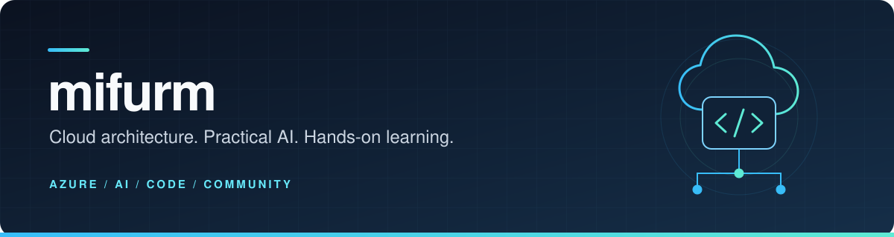

# Hi, I'm mifurm

**Engineering Lead & Cloud Architect**

[Microsoft](https://github.com/microsoft) · [Explore my repositories](https://github.com/mifurm?tab=repositories)

---

## From architecture to working code

My repositories bring together Azure infrastructure, AI experiments, and hands-on
workshops. You'll find cloud networking labs, Terraform deployments, PowerShell
utilities, and small projects that make complex ideas easier to explore.

**My focus**

- **Cloud foundations** — Azure networking, infrastructure as code, and cloud-native platforms.
- **Practical AI** — Microsoft Foundry, agents, model evaluation, and local model experiments.
- **Learning by building** — workshops, reproducible demos, and classroom projects with code to inspect and run.

## Projects worth exploring

| Project | What you'll find |
| :--- | :--- |
| [**Foundry Workshop Demos**](https://github.com/mifurm/FoundryWorkshopDEMOS) | Hands-on labs for Microsoft Foundry and Microsoft Agent Framework, with Python, infrastructure, and tests. |
| [**Mini GPT Classroom**](https://github.com/mifurm/mini-gpt-classroom) | A tiny Transformer trained from scratch, with recorded experiments and interactive explanations of how GPT works. |
| [**Azure AI Landing Zone**](https://github.com/mifurm/AzureAILandingZone) | Terraform infrastructure for Azure AI, including Microsoft Foundry and AI Hub. |
| [**Azure Network Workshop**](https://github.com/mifurm/AZNetWorkshop) | Azure networking workshop materials and infrastructure code. |
| [**Azure Cleaner**](https://github.com/mifurm/AzureCleaner) | PowerShell scripts to identify potentially unused or orphaned Azure resources. Detection only; no resource deletion. |

## My toolbox

**Cloud & infrastructure**

Azure · Terraform · Kubernetes · Docker · PowerShell

**AI & application development**

Microsoft Foundry · Python · PyTorch · C# / .NET · JavaScript / TypeScript

## More hands-on learning

[ARM Workshop](https://github.com/mifurm/ARMWorkshop) ·
[Kubernetes Exercises](https://github.com/mifurm/k8s) ·
[Serverless Workshop](https://github.com/mifurm/serverlessWorkshop) ·
[Local Models with ONNX](https://github.com/mifurm/onnxLocalModels)

---

**Explore the code. Try a lab. Build something useful.**

[Browse all repositories](https://github.com/mifurm?tab=repositories)

